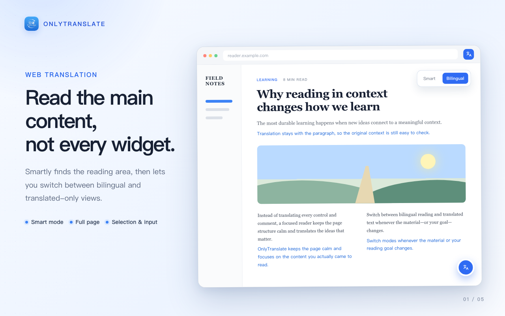
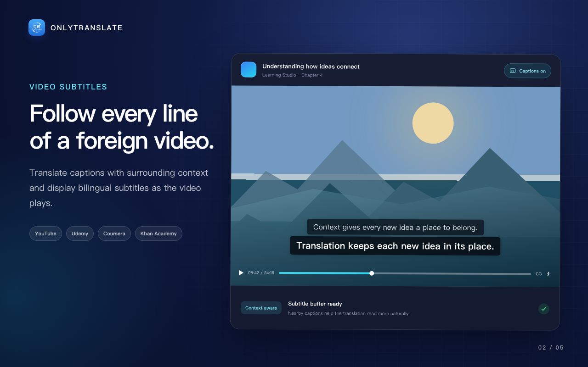
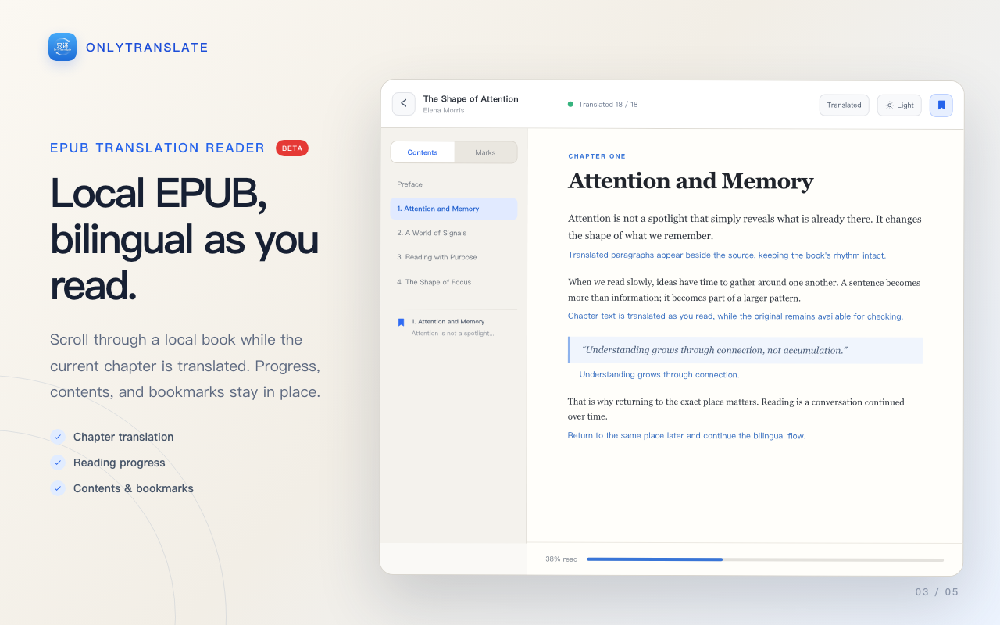
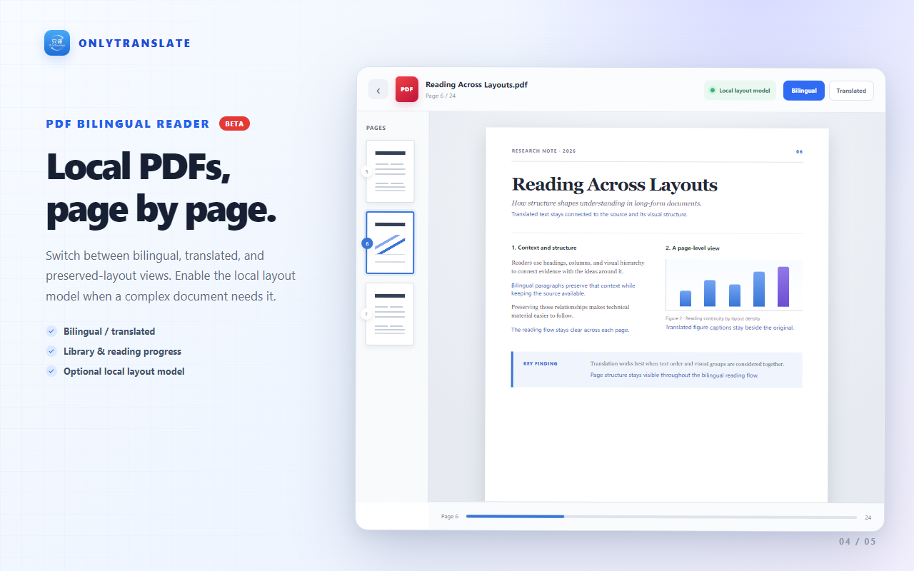

# OnlyTranslate

> 機能は確かに、余計なことはしない。得意なことはただ一つ、翻訳です。

[中文](./README.md) | [English](./README_EN.md) | 日本語 | [公式サイト](https://onlytranslate.top/)

OnlyTranslate は、Chrome、Edge、Firefox に対応したオープンソースの対訳リーディング拡張機能です。ウェブコンテンツ、動画字幕、ローカルの EPUB 電子書籍、ローカルまたはオンラインの PDF を、元の構造と読みの流れをできるだけ保ったまま翻訳します。OnlyTranslate のアカウントやサブスクリプションは不要で、翻訳サービスはご自身で選べます。

[](./LICENSE)
[](https://chromewebstore.google.com/detail/%E5%8F%AA%E8%AF%91/hiajidipndfdngigicngbkhbjolggifi?utm_source=github&utm_medium=referral&utm_campaign=readme_202608)
[](https://microsoftedge.microsoft.com/addons/detail/onlytranslate/alhgdpecglfndjbombednkkdgpagllbc)
[](https://addons.mozilla.org/en-US/firefox/addon/onlytranslate/)

<p align="center">
  
  
</p>
<p align="center">
  
  
</p>

> OnlyTranslate がお役に立ちましたら、ぜひ ⭐ **Star** を付けてプロジェクトを応援し、より多くの人がオープンソースの対訳リーディングツールを見つけられるようご協力ください。

## クイックスタート

1. お使いのブラウザーのストアから OnlyTranslate をインストールします：[Chrome Web Store](https://chromewebstore.google.com/detail/%E5%8F%AA%E8%AF%91/hiajidipndfdngigicngbkhbjolggifi?utm_source=github&utm_medium=referral&utm_campaign=readme_202608)、[Microsoft Edge Add-ons](https://microsoftedge.microsoft.com/addons/detail/onlytranslate/alhgdpecglfndjbombednkkdgpagllbc)、または [Firefox Add-ons](https://addons.mozilla.org/en-US/firefox/addon/onlytranslate/)。その後、翻訳したい通常のウェブページを開きます。
2. ブラウザーのツールバーにある OnlyTranslate のアイコンを選択し、利用可能な翻訳サービスを選びます。Microsoft Translator や Google 翻訳など設定不要のサービスはすぐに使えます。AI サービスには対応する API キーが必要です。
3. 初めて翻訳するときは **対訳 + 本文** を試してから、**このページを翻訳** を選択してください。翻訳を元に戻したいときは、いつでも **原文に戻す** を選択します。

電子書籍や PDF を読むには、ポップアップ下部の **読書**（BETA）を選び、ローカルの DRM フリーの EPUB または PDF をインポートします。アクセス可能なオンライン PDF を OnlyTranslate で開き、本棚に保存することもできます。ポップアップから続きを読むか、完全な本棚で書籍の管理、バックアップ、復元を行えます。

ポップアップ右上の **その他** メニューには、キャッシュの削除とヘルプがあります。ヘルプでは、翻訳モード、選択翻訳とホバー翻訳、入力欄、動画字幕、サービスの設定、よくある問題について検索可能な説明を提供しています。ガイドは拡張機能に同梱されており、オフラインでも利用できます。

## 主な機能

- **スマート / ページ全体の翻訳**：本文モードは記事、コメント、メインの読み取り領域に焦点を当てます。全ページモードは、ドキュメント、フォーラム、ツールページなどで、より多くの表示テキストをカバーします。
- **対訳 / 翻訳のみの表示**：比較や語学学習のために原文を残すことも、すっきり読めるように翻訳だけを表示することもできます。
- **多彩な翻訳の起動方法**：拡張機能のポップアップ、ページ上のフローティングツールバー、キーボードショートカット、またはコンテキストメニューから翻訳を開始できます。
- **選択・ホバー・入力欄の翻訳**：選択した内容やポインター下のテキストを翻訳し、キャレットの横で候補をプレビューし、その場でターゲット言語を切り替え、`Tab` を押して原文を置き換えられます。
- **動画字幕の翻訳**：対応サイトで元の字幕を取得し、文脈を考慮したセグメント単位で翻訳して、対訳字幕を表示します。再生状況に応じたスケジューリングとローカルキャッシュにより、待ち時間や重複リクエストを減らします。
- **EPUB 電子書籍の翻訳（Beta）**：ローカルの DRM フリーの EPUB 書籍をインポートでき、章の自動翻訳、目次、読書の進捗、しおり、読書スタイルの調整に対応しています。
- **PDF ドキュメントの翻訳（Beta）**：ローカルまたはアクセス可能なオンライン PDF を、ページのサムネイル、対訳 / 翻訳のみ / 原文のみのモード、原文ページとの比較とズーム、図や数式の表示とともに読めます。オプションのローカルレイアウトモデルにより、複雑なページでの読み順が改善されます。
- **柔軟な翻訳サービス**：Microsoft Translator、Google 翻訳、Chrome の組み込み翻訳、DeepL、OpenAI、DeepSeek、Gemini、Claude などのプリセットに加え、OpenAI Chat Completions 互換のゲートウェイにも対応しています。
- **高度な AI 設定**：サービスごとに思考モードを個別に制御でき、デフォルトのターゲット言語と、オプションの逆翻訳言語を設定できます。
- **組み込みのユーザーガイド**：検索可能なオフラインの説明とインターフェースのスクリーンショットを、簡体字中国語、英語、繁体字中国語、日本語で利用できます。

## 翻訳範囲の選び方

- **本文**：記事、ブログ、投稿、コメント、長文の読み物に最適です。メインの読み取り領域を優先し、メニューやナビゲーションによるノイズを減らします。
- **全ページ**：ドキュメント、管理画面、フォーラム、ツールサイト、情報量の多いページに最適です。元のページ構造と操作をできるだけ保ちながら、より多くの表示コンテンツを翻訳します。

本文モードで内容が漏れる場合は、全ページに切り替えてもう一度翻訳してください。動的に読み込まれるコンテンツは、スクロールして表示させてから再度翻訳を実行してください。

## 読書と本棚（Beta）

ポップアップ下部の **読書** を選ぶと、EPUB/PDF ファイルのインポート、最近読んだ書籍の表示、続きからの読書ができます。完全な本棚では、書籍の管理、元ファイルのエクスポート、ローカル本棚のバックアップと復元に対応しています。

### EPUB 電子書籍

ローカルの DRM フリーの EPUB をインポートすると、読み進めるにつれて現在の章が自動的に翻訳されます。リーダーは、目次、読書の進捗、位置のしおり、テーマ、フォントサイズ、行間に対応しています。

### PDF ドキュメント

- **開く・保存する**：ローカルの PDF は **読書** からインポートします。オンライン PDF を閲覧しているときは、ポップアップで **OnlyTranslate でこの PDF を読む** を選ぶか、PDF リンクのコンテキストメニューを使います。オンラインのドキュメントは直接アクセスできる必要があります。後で続きを読むには本棚に追加してください。
- **読む・比較する**：ツールバーで対訳、翻訳のみ、原文のみのモードを直接切り替えられます。サイドバーでは目次とページのサムネイルを切り替えられます。埋め込みの目次はデフォルトで開き、展開可能なセクションから目的のページと位置へ移動できます。埋め込みの目次がない PDF ではサムネイルを使います。原文プレビューを折りたたんだり、区切り線をドラッグして原文と読書フローのペインを調整したりできます。テーマ、フォントサイズ、行間は設定可能です。
- **論文と数式**：リーダーは、段組みやページをまたいで続く段落の再構成を試みます。インラインの数式は数式組版に対応し、独立した数式や図は元の画像を保持し、ダブルクリックで拡大できます。複雑なドキュメントでの結果は、引き続き元ファイルの構造に依存します。
- **移動とズーム**：`←` / `→` でページを切り替えます。原文ページ上で `Ctrl` / `⌘` を押しながらマウスホイールをスクロールすると、ポインターを中心にズームします。
- **オプションのレイアウトモデル**：基本的なレイアウト解析には追加のダウンロードは不要です。複雑な PDF では、リーダー上部のツールバーにあるレイアウトモデルのコントロールを使って、約 23 MB の PP-DocLayout-M モデルを明示的にダウンロードします。検証済みのモデルは拡張機能のプライベートストレージに保存され、いつでも削除できます。モデルがない場合、ダウンロードに失敗した場合、または実行時に失敗した場合は、自動的に基本解析へフォールバックします。
- **ファイルと制限事項**：**その他** メニューから元の PDF をエクスポートできます。翻訳にはページから抽出可能なテキストが必要です。画像のみのスキャンは翻訳できない場合があり、オプションのレイアウトモデルは OCR による文字認識を提供しません。

### ローカルストレージと制限事項

- ローカルの DRM フリーの EPUB と PDF ファイルに対応しており、アクセス可能なオンライン PDF は本棚に保存できます。MOBI や DRM/パスワードで保護された書籍にはまだ対応していません。
- 書籍、読書の進捗、EPUB のしおりは、現在のブラウザープロファイルに保存されます。完全な本棚からバックアップと復元ができますが、クラウド同期、メモ、AI 分析は含まれていません。
- 元の EPUB/PDF ファイルが翻訳プロバイダーやモデルのホストに送信されることはありません。抽出されたテキストは、翻訳を開始したときにのみ、選択した翻訳プロバイダーへ送信されます。PDF の原文のみモードでは、翻訳用にテキストを事前送信しません。
- 書籍を削除すると、その読書の進捗としおりも削除されます。拡張機能をアンインストールしたり拡張機能のデータを消去したりするとローカルの本棚が削除されるため、先に **本棚をバックアップ** を使ってください。
- インポートした書籍は拡張機能が無効の間も読めますが、自動翻訳は一時停止します。

## 対応プラットフォーム

ウェブ翻訳はほとんどの通常のウェブページで動作します。ブラウザーの内部ページ、拡張機能ストア、セキュリティ上制限されたページ、一部の埋め込みコンテンツでは、拡張機能が動作しない場合があります。

| プラットフォーム | 字幕翻訳 | ウェブ翻訳 |
|----------|----------------------|-----------------|
| YouTube | 対応 | 対応 |
| Udemy | 対応 | 対応 |
| Coursera | 対応 | 対応 |
| Khan Academy | 対応 | 対応 |
| 一般的なウェブページ | — | 対応 |

字幕翻訳には、動画が提供する読み取り可能な元の字幕トラックが必要です。

## プライバシーと費用

- OnlyTranslate 自体は無料のオープンソースです。プロジェクトのために利用データを収集することはなく、設定はブラウザー内にローカル保存されます。
- オンライン翻訳サービスを使用すると、翻訳対象のテキストは選択したプロバイダーへ送信され、そのプロバイダーのプライバシーポリシーが適用されます。
- インポートした EPUB/PDF ファイル、読書の進捗、しおり、オプションの PDF レイアウトモデルは、ブラウザーのローカルストレージに保存されたままです。選択したプロバイダーに送信されるのは、翻訳が必要なテキストだけです。
- Chrome の組み込み翻訳はブラウザー内でローカルに動作しますが、利用可否は Chrome のバージョン、言語ペア、ローカルモデルの状態によって異なります。
- 一部のオンラインサービスでは API キーが必要で、各サービスの規約に従って料金が発生する場合があります。OnlyTranslate はプロバイダーのアカウント、クォータ、請求を管理しません。
- 重複リクエストを減らすため、翻訳結果や動画字幕はローカルにキャッシュされる場合があります。ポップアップ右上の **その他** メニューにある **キャッシュを削除** で削除できます。

## インストール

### ブラウザー拡張機能ストア

- [Chrome Web Store](https://chromewebstore.google.com/detail/%E5%8F%AA%E8%AF%91/hiajidipndfdngigicngbkhbjolggifi?utm_source=github&utm_medium=referral&utm_campaign=readme_202608)
- [Microsoft Edge Add-ons](https://microsoftedge.microsoft.com/addons/detail/onlytranslate/alhgdpecglfndjbombednkkdgpagllbc)
- [Firefox Add-ons](https://addons.mozilla.org/en-US/firefox/addon/onlytranslate/)

### GitHub Releases からの手動インストール

[Releases](https://github.com/airhunter/OnlyTranslate/releases) で、お使いのブラウザー用のパッケージを選びます：`OnlyTranslate-v<version>-chrome.zip`、`OnlyTranslate-v<version>-edge.zip`、または `OnlyTranslate-v<version>-firefox.zip`。古いリリースには 3 つすべてのパッケージが含まれていない場合があります。

- **Chrome / Edge**：対応するパッケージを解凍し、`chrome://extensions/` または `edge://extensions/` を開いて **デベロッパー モード** を有効にし、**パッケージ化されていない拡張機能を読み込む** を選択します。`manifest.json` を含む解凍済みディレクトリを選んでください。
- **Firefox での開発テスト**：通常の利用には、上記の Firefox Add-ons からインストールしてください。GitHub Releases の Firefox 用 ZIP は、`about:debugging#/runtime/this-firefox` の **一時的なアドオンを読み込む** から読み込めます。Firefox を再起動した後は再度読み込む必要があります。[Mozilla の一時的なインストールのガイド](https://extensionworkshop.com/documentation/develop/temporary-installation-in-firefox/)を参照してください。

## 開発

```bash
# Install dependencies
corepack pnpm install

# Development mode for Chrome
corepack pnpm dev

# Type checking and the full test suite
corepack pnpm verify

# Build and package all three browser versions
corepack pnpm build
corepack pnpm zip:all
```

このプロジェクトは `package.json` で pnpm のバージョンを宣言しています。スクリプトがプロジェクトの想定するパッケージマネージャーのバージョンとローカル依存関係を使うよう、`corepack pnpm ...` の使用を推奨します。

開発モードでは、Chrome のデベロッパーモードで `.output/chrome-mv3-dev` を読み込みます。本番ビルドでは `.output/chrome-mv3` を読み込みます。2 つの出力ディレクトリを混在させないでください。

技術スタック：[WXT](https://wxt.dev/) + [Vue 3](https://vuejs.org/) + TypeScript、Manifest V3。

提案されている改善点とその状況については[プロダクトロードマップ（中国語）](./ROADMAP.md)を、リリース済みの機能については[変更履歴](./CHANGELOG.md)を参照してください。

## フィードバック

翻訳が開始されない、ページが一部しか翻訳されない、字幕が表示されないといった場合は、まず組み込みのガイドを確認してください。それでも問題が解決しない場合は、[GitHub Issues](https://github.com/airhunter/OnlyTranslate/issues) から報告してください。

## クレジットと由来

OnlyTranslate は [FluentRead](https://github.com/Bistutu/FluentRead) をベースにしています。中核となるウェブページ翻訳の体験を維持しながら、動画字幕の翻訳、EPUB と PDF の対訳リーディング、本文 / 全ページの範囲切り替え、より洗練された設定画面を追加しました。原作者とすべてのコントリビューターのオープンソースの取り組みに感謝します。

OnlyTranslate の EPUB リーダーの設計と実装は、[taylorren/ai-reader](https://github.com/taylorren/ai-reader) から着想を得ています。オープンソースのアイデアと成果を共有してくださったこのプロジェクトとそのコントリビューターに感謝します。

PDF のセマンティックなレイアウト解析には、PaddleOCR の PP-DocLayout-M モデルと ONNX Runtime Web を使用しています。このモデルはオプションで、ユーザーが自ら開始した場合にのみダウンロードされます。その出所、チェックサム、ライセンス情報については [THIRD_PARTY_NOTICES.md](./public/THIRD_PARTY_NOTICES.md) を参照してください。

オープンソースの交流と協力の場を提供してくださっている [LINUX DO](https://linux.do/) コミュニティに感謝します。

## ライセンス

このプロジェクトは [GNU GPL v3.0](./LICENSE) ライセンスの下でオープンソースとして公開されています。
