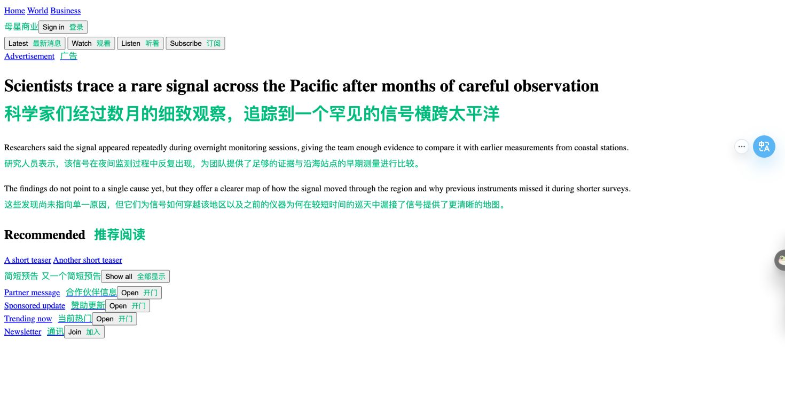
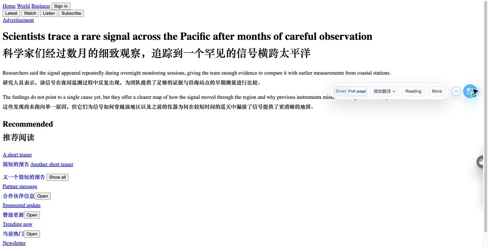

# Full Page 同页对照与第一阶段验收

日期：2026-10-19  
状态：四组双语结构样本已实机对照；方案待确认，未修改功能代码  
分支：`codex/page-translation-redesign`

真实网站对照补充见 [主页/正文配对报告](./fullpage-real-comparison-20261019.md)。本文件保留本地结构样本结果，不代表真实网站验收；第一阶段还须满足补充报告的 R-AC1–R-AC6。

## 结论

第一阶段的目标是：用户选择 Full Page 后，普通 HTML 页面中正文以外的导航、按钮、表单说明、列表表头和翻页文案，也能被翻译；沿用用户的双语或仅译文选择，保留原有交互与恢复能力。识文行为维持现状。

实测缺口集中在界面文字过滤和展示路径。不能概括为“我们只翻正文”：侧栏、推荐和推广链接已经部分覆盖；展开目录后的链接也已有补译能力。第一阶段不重写整套扫描和调度，也不把独立属性、iframe、标题翻译和自动范围一起加入。

## 测试条件与证据边界

- Chrome 中实际操作两个已安装扩展。Read Frog 设置页显示版本 **1.51.0**；此前源码审计固定的提交是 `fcb00beb21a9d674c0262346fbc422fbbf317c03`，未证明商店包与该提交完全一致。
- OnlyTranslate 仓库基线是 `d8569f3`，本轮未重新构建或替换扩展。实测反映当前浏览器已加载的版本，未独立核实其加载目录与 Git 提交的逐字对应关系。
- Read Frog：**All content / Bilingual / Microsoft Translator**；OnlyTranslate：**Full page / 双语 / 微软翻译**。目标简体中文，英文样本。只比较覆盖与结构行为，不评价译文质量；虽同为微软服务，未断言两边请求实现相同。
- 使用仓库已有 HTML，未修改 fixture；通过 `http://127.0.0.1:8766/` 提供。每次只启动一个扩展；切换扩展前停止并重载，同页重新设置表单状态。
- **本地地址不命中原网站的域名 profile。** Partner Center 和论坛样本只证明通用结构行为，不能当作真实 Partner Center、Ziggit 或 Threads 的站点适配结果。
- 样本缺少真实网站完整样式，截图只能说明这些结构的实际布局，不能证明复杂网站、移动端或所有视窗尺寸均正常。
- 两扩展共存时，Read Frog 还会翻译 OnlyTranslate 工具栏文案。结果只统计样本内容，切换前重载隔离；没有把工具栏译文算作网页覆盖。
- 本轮未记录网络请求体、完整目标决策日志或事件节点身份。因此“出现译文”是显示证据；过滤原因来自此前源码审计，不能写成现场拦截日志。

截图和 DOM 可访问快照存放在 [证据目录](./assets/fullpage-comparison-20261019/)。每个 `*-bilingual.png` 有同名 `.txt` 快照。源文件及 SHA-256：

| 样本 | 原有 fixture | SHA-256 |
| --- | --- | --- |
| S1 文章、导航、按钮、侧栏 | [generic-heavy-ui-article.html](../../tests/fixtures/translation-target/generic-heavy-ui-article.html) | `3941dfdd00e520987a39ab63ac612575b3ee4f2cd6c2962b87afb5361d63d4eb` |
| S2 通用表单 | [microsoft-partner-center-properties.html](../../tests/fixtures/translation-target/microsoft-partner-center-properties.html) | `f85100442536c1ab1dcc52c54792a0c83323173ec0a002a86f3b5028ff96b48e` |
| S3 通用论坛列表 | [forum-topic-list.html](../../tests/fixtures/translation-target/forum-topic-list.html) | `687fd11a3149d7200461c03b785769972d90a16b0bed27746a4cacce00852e77` |
| S4 可展开嵌套目录 | [lilianweng-nested-toc.html](../../tests/fixtures/translation-target/lilianweng-nested-toc.html) | `1d5411dd04cdcff739ca91cff437878288851c97eae4b80a6923f3606279f360` |

## 实际结果

| 样本和区域 | Read Frog all 双语 | OnlyTranslate Full Page 双语 | 对第一阶段的含义 |
| --- | --- | --- | --- |
| S1 标题和两段正文 | 有译文 | 有译文 | 保留已有正文能力 |
| S1 Home / World / Business 导航 | 有译文，组合成一段 | 无译文 | 纳入普通导航；分组不能使链接目标混淆 |
| S1 Sign in、Latest、Watch、Listen、Subscribe | 按钮内有行内译文 | 无译文 | 按钮显示文字与安全插入必须一起做 |
| S1 Advertisement | 有译文 | 无译文 | 不因为是非正文标签就默认丢弃 |
| S1 Recommended、两条 teaser、四条推广链接 | 有译文 | 有译文 | 不把侧栏整体列为缺失，也不重做已覆盖部分 |
| S1 Show all / Open / Join 按钮 | 有译文 | 无译文 | 和顶部按钮同类处理 |
| S2 Properties 标题 | 有译文 | 有译文 | 基础标题正常 |
| S2 Save & Continue、Category、Support details、Website、Support contact detail、Mature content | 有译文 | 无译文 | 放开表单中的静态标签、分组标题和操作文案 |
| S2 帮助说明、Learn More、复选框旁说明 | 有译文 | 无译文 | 表单静态文案不能随输入区域整体跳过 |
| S2 select 的 Pick a category / Productivity | 仍是英文 | 仍是英文 | 本轮未证实竞品覆盖原生 option，暂不作为对齐必交项 |
| S2 placeholder | 仍是英文 | 仍是英文 | 不据属性 helper 推导全页独立属性能力 |
| S2 网站值、选项、复选框 | 值和状态保留 | 值和状态保留 | 扩容后必须继续保留；没有提交表单 |
| S3 Topic 表头、两条主题、Showcase | 有译文 | 有译文 | 保留已有命中 |
| S3 Replies / Views / Activity 表头 | 有译文 | 无译文 | 修正表格内部过滤与目标分组 |
| S3 Brainstorming / language 分类和 next page | 有译文 | 无译文 | 覆盖分类及翻页文字，不用长度作为唯一判断 |
| S3 alice bob / carol、日期 | 名字与日期都有译文 | 名字有译文，日期无译文 | 两边均可能翻译名字；“跳过用户名”不是已验证的竞品通用规则 |
| S3 25 / 1069 / 12 / 540 | 保持数字 | 保持数字 | 保留纯数字过滤 |
| S4 Table of Contents 展开控件标题 | 有译文 | 无译文 | summary 的界面文案属于明确缺口 |
| S4 翻译开始后展开的 14 个目录链接 | 展开后全部出现译文 | 展开后全部出现译文 | 现有显现/动态能力可复用，不应声称我们不会动态补译 |
| S4 元信息日期、作者行 | 有译文 | 无译文 | Full Page 不应统一套用阅读元信息排除 |
| S4 停止/恢复 | 样本内容恢复英文 | 样本内容恢复英文，目录仍展开 | 已有恢复基础；未覆盖竞态、节点复用和全部控件 |

S2 两次都使用网站值 `https://example.test`、选中 Productivity、复选框勾选；支持联系方式没有作为状态比较项目。没有向表单执行保存操作。

S4 先用原生 summary 将目录收起，再启动翻译，最后展开。只证明显现后的翻译结果，不证明译文请求一定在展开之后才发出。OnlyTranslate 展开后样本 main 中记录到 17 个已翻译目标，Read Frog 译文包装为 0，排除了另一扩展残留造成的假阳性。

### S1 截图

Read Frog all：顶部导航、按钮和正文均有译文。

OnlyTranslate Full Page：正文和部分侧栏已有译文，顶部导航与按钮仍是英文。视窗内工具栏展开、页面高度和截图滚动条不同，不以像素差异计算覆盖率。

## 第一阶段具体修改清单（尚未实施）

第一阶段交付的是“普通 HTML 全页文字覆盖与安全显示”。以下条目一起验收；不能先发布仅放宽过滤、仍可能重建按钮或覆盖输入状态的版本。

| 项目 | 拟修改内容及主要位置 | 明确边界 |
| --- | --- | --- |
| P1-1 区分阅读排除和内容保护 | 在 `translationTarget/collect.ts`、`decision.ts`、`dom.ts` 贯通 scope；full 放开普通导航、按钮、summary、表头和表单静态文案，不再因 UI/metadata 分类统一否决 | smart 原有规则不变；输入值、编辑区、代码、公式、自身 UI、译文继续保护。不是删除所有 skip |
| P1-2 补正文外的目标分组与短文案 | 复用 direct-text run 和嵌套去重；补相邻链接、独立按钮、label/说明和表格单元格；核对 `translationDirection.ts` 的短词语言判断 | 不把每个 span 都拆请求，不跨独立控件拼译文；纯数字仍跳过。Go/OK 等须补验证，现有四组不能证明全部短词 |
| P1-3 安全显示与恢复 | 在 `trans.ts`、`translationOnly.ts` 复用会话与原文校验；双语在紧凑控件采用行内布局，补真实主页卡片摘要的译文可见性；仅译文优先更新 Text，保留原控件和链接节点 | 不把新增控件送进整块 HTML 替换；不强迫按钮仅译文，不全局删除网页裁切样式。无法安全对齐的目标保留原文，不重建交互节点 |
| P1-4 初始与动态范围一致 | 在 `translationTarget/dynamic.ts` 和观察入口复用同一 full 策略，补菜单显现、节点文字改变、新增及复用回归 | 保留已有 mutation 合并、取消、缓存与近视区队列；不是重写动态引擎 |
| P1-5 回归站点规则 | 核查 profile 中哪些是阅读范围、哪些是布局/去重/输入保护；为实际受影响规则补对应域名 fixture 和实机证据 | 不因 localhost 表单结果直接改 Partner Center，不因本轮结果直接清空 Threads profile；复杂动态站点另行核对 |

文件位置均相对 `entrypoints/main/`；`translationDirection.ts` 位于 `entrypoints/utils/`。具体新增 helper 和数据结构在实现前按最小改动确定，本轮不预设重构。

预期匹配路径：可见页面文字 → 区域与保护判定 → 独立结构分组 → 文本/语言过滤 → 原有翻译队列 → 按用户模式安全显示 → 原有会话校验和恢复。full 的“不是正文”不再直接等于拒绝。站点安全排除仍有效；没有可安全显示的结果时保留原文。

主要回归风险是重复翻译、菜单串段、按钮尺寸增长、事件节点丢失、把输入值当文案、动态内容被旧响应覆盖及扫描成本上升。用下面的逐项验收阻止这些风险，而不是仅检查页面出现了中文。

## 第一阶段验收标准

| 编号 | 可检查的通过条件 | 验证方式 |
| --- | --- | --- |
| AC1 已知覆盖 | S1 导航、所有命名按钮及 Advertisement；S2 上表静态标题/标签/说明；S3 三个漏译表头、分类、日期行及 next page；S4 summary 和元信息行均进入 full 目标并显示译文。已有正文、侧栏和 14 条目录链接继续覆盖 | 补静态 fixture 明确文本与目标断言；构建后用同版本包、同服务逐项复测双语和仅译文。服务失败单列，不能以无响应通过覆盖验收 |
| AC2 分组和短词 | 独立按钮/菜单项保持独立；句中链接保留上下文且不重复翻译父子；Go、OK、目标语言短词、纯数字、@handle 有明确预期和原因 | 补最小结构 fixture；检查目标集合与请求分组，避免只数译文节点 |
| AC3 展示和交互 | 双语保留原文，仅译文不额外显示原文；原 button/a/input/select 节点身份、href、value、checked、选择状态不被替换；点击/键盘操作各触发一次，输入焦点不丢失 | 代码测试记录节点引用与事件次数；实机在普通及窄视窗核查按钮可见、可点击，无遮挡和横向溢出；双语可合理增高，不要求像素不变 |
| AC4 动态一致 | 翻译后打开目录/菜单、新增控件文案、修改文字、复用节点，都按 full 规则处理且每个当前目标只显示一份译文 | 动态代码测试加实机；S4 用“先收起 → 翻译 → 展开 → 再收起/展开”复测，不用修改源码制造既成结果 |
| AC5 恢复与竞态 | 恢复清掉自身译文；保持原有输入状态和网站后来写入的新文本；恢复、导航或目标复用后，迟到响应不能回写旧内容 | 受控延迟结果、取消和复用代码测试；浏览器复测输入后翻译/恢复，不向真实站点提交表单 |
| AC6 保护与识文回归 | smart 的正文目标、已有站点适配保持原预期；full 不翻用户输入/草稿、contenteditable、代码/公式、自身 UI 与已生成译文 | 原有断言保持；新增正反例，不能批量改 fixture 预期来掩盖回归 |
| AC7 性能与完成状态 | 同一样本不会因译文插入反复入队；滚动与连续展开时可继续操作；取消后不继续写入。大型列表记录节点、请求、耗时和重复情况，与旧包比较，异常增长先解释 | 复用现有 benchmark/预算；固定浏览器与样本，记录前后数值。尚无本轮性能基线，不编造已达成的毫秒指标 |

实施后运行 `pnpm test:content`；共享目标/插入逻辑完成后运行 `pnpm verify`，构建 Chrome 包并完成上表实机验收。不能用当前包的 207 个通过测试代替新增行为验收。

## 本轮未覆盖与后续阶段

- 当前只完成上述四组 **all/full + 双语** 比较。仅译文、main/smart 对照、真实网站 profile、实际事件身份、窄视窗、复杂菜单及服务失败仍待验证；不能称整张差异表实机验收完成。
- 原生 select/option、独立 placeholder/alt/aria、HTML 片段属性保护在后续单独验证。S2 未看到前两项被竞品翻译，不列为本轮已经确认的覆盖差距。
- `translate=no`、分层 `notranslate`、body 外节点、text/plain 的差异保留在源码差异表；缺少本轮样本，不混入第一阶段无条件放宽。
- 标签页标题与 iframe 仍是已登记的后续能力缺口；结构自动选择是再后续需求。第一阶段完成也不能称 Read Frog all 已完整对齐。

## 已执行检查与环境收尾

现有基线检查：`pnpm exec vitest run tests/utils/autoTranslateTargetFixtures.test.ts tests/utils/autoTranslateTarget.test.ts tests/utils/translationOnly.test.ts`，**3 个文件、207 个测试通过**。这些是模拟环境中的既有测试，未新增断言，不代表真实服务和浏览器全部场景通过。

测试后已通过网页工具栏将 OnlyTranslate 恢复为原来的 **Smart + BiliBili**，并恢复 S4 原文。Read Frog 翻译已停止；其设置仍为本次对照的 **Microsoft Translator + All content + Bilingual**。原设置为 Google Translate + Main content + Bilingual。浏览器工具拒绝访问扩展设置协议页面，因此没有绕过限制恢复；如需恢复原偏好，须用户在 Read Frog 设置中操作。

本轮只新增报告、截图/快照并更新设计与 Roadmap，不修改代码、测试、依赖或配置，不提交或推送。
