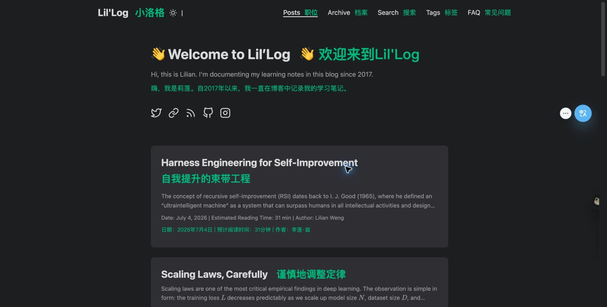
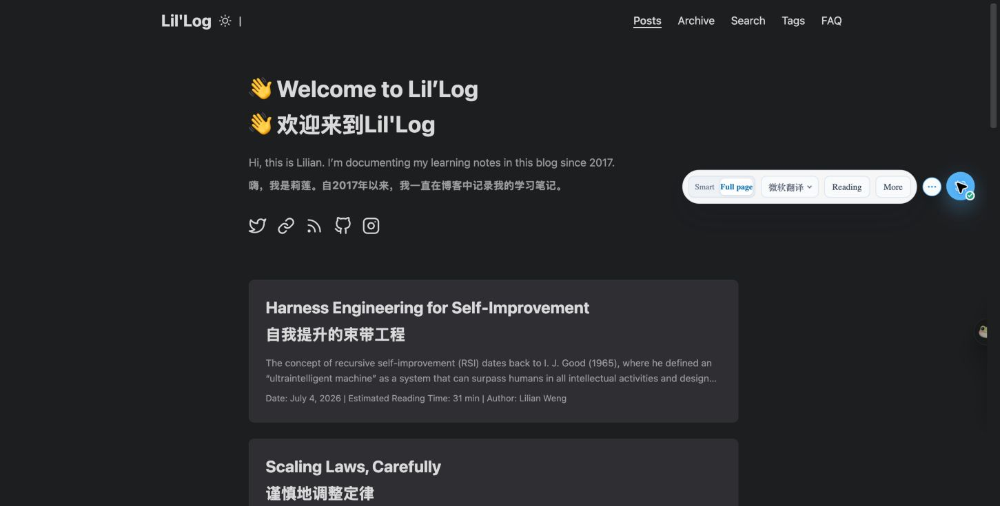
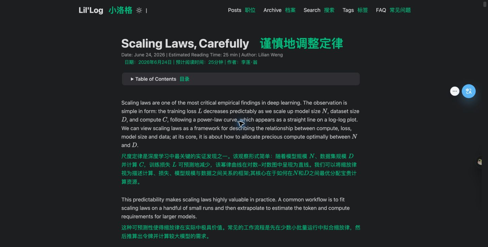
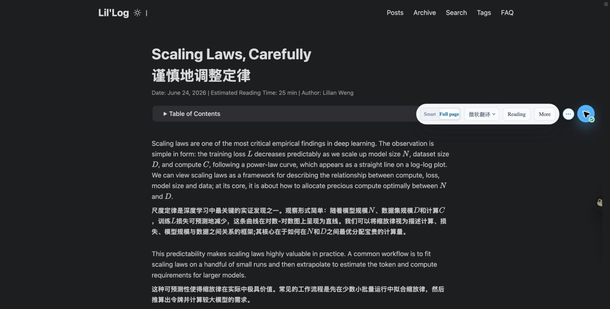
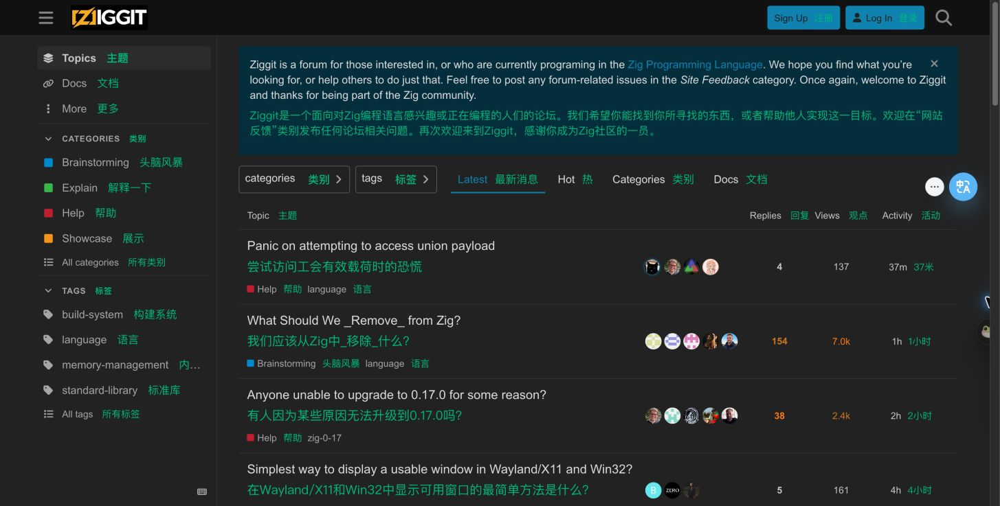
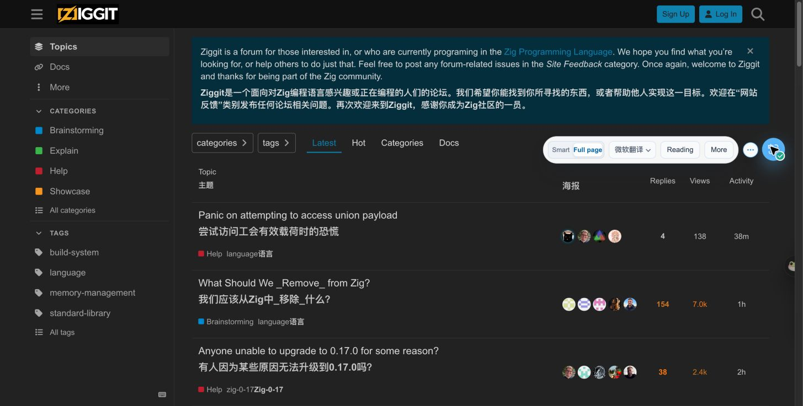
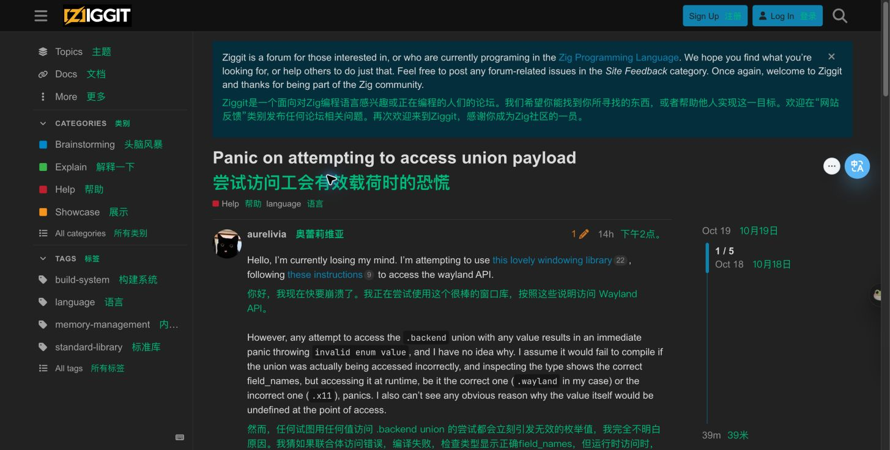
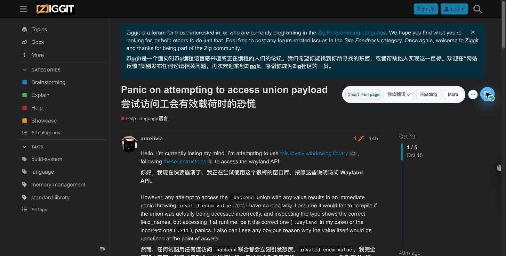

# 真实网页主页与正文对照

日期：2026-10-19  
状态：两个真实网站、两组主页/正文配对已完成双语观察；未修改功能代码

后续结论见 [当前模式对照与第一阶段方案](./fullpage-mode-comparison-20261019.md)。本报告是先前的双语观察；后续博客/论坛 32 个模式组合已观察，Threads 对照不完整。2026-10-20 维护者确认 Chrome 中的 OnlyTranslate 为发布版，并要求停止实测。所有 OnlyTranslate 实机记录按发布版解读，不能用作当前设计分支的验收；不再追加测试。

## 本次补正

此前 [四组本地结构样本](./fullpage-comparison-20261019.md) 只能帮助定位规则，不能代替真实网页、真实域名 profile 和真实布局验收。本报告补充同站主页与正文的实际结果，第一阶段方案以两类证据共同约束，不把结构样本当网站验收。

| 网站类型 | 主页/列表 | 正文/详情 | 配对用途 |
| --- | --- | --- | --- |
| 博客 | [Lil’Log 主页](https://lilianweng.github.io/) | [Scaling Laws, Carefully](https://lilianweng.github.io/posts/2026-06-24-scaling-laws/) | 区分欢迎区、文章卡片、导航、摘要与文章正文、目录、元信息 |
| 动态论坛 | [Ziggit 主页](https://ziggit.dev/) | [Panic on attempting to access union payload](https://ziggit.dev/t/panic-on-attempting-to-access-union-payload/18027) | 区分侧栏、列表/排序与主帖、回复、作者区、代码；验证真实域名规则 |

另尝试打开 Threads 首页，浏览器导航超时，未形成可核对页面，**没有将 Threads 计入已完成对照**。新闻站、信息流及仅译文仍不能由这两个网站代替。

## 条件和判定方式

Read Frog 沿用已确认的 1.51.0、All content、Bilingual、Microsoft Translator；OnlyTranslate 使用 Full page、双语、微软翻译。沿用此前已加载扩展，没有重新构建、安装或改代码；仓库提交与实际安装包逐字对应关系仍未独立验证。

每个页面分别启动两个扩展，切换前停止并重载，检查另一扩展在页面内容中的译文残留为零。对照语言方向为英文到简体中文；同为微软服务不等于请求实现相同，不以译文措辞评价覆盖。

必须等待**实际译文出现**再截取最终证据。博客主页第一次 OnlyTranslate 截图还在等待服务，不能据此判定欢迎区/标题漏翻；已用最终截图和 JSON 替换。口头进度中先前对欢迎区漏翻的判断已纠正。

证据在 [截图与结构观察目录](./assets/fullpage-real-20261019/)。JSON 仅记录相关区域、已出现的文字和状态，没有网络请求体或内部决策日志。大页面、动态帖子不以一次 DOM 总数计算覆盖率：Read Frog 的近视区调度、我们的后台翻译，以及论坛虚拟化都会使节点数量不同。

## 配对一：真实博客

| 检查区域 | Read Frog all | OnlyTranslate Full Page | 结论 |
| --- | --- | --- | --- |
| 主页欢迎标题与介绍 | 有译文 | 等待返回后有译文 | 已有能力，不能列为范围缺失 |
| 主页文章标题 | 首批卡片有可见译文 | 首批卡片有可见译文 | 主页标题不是整体漏翻 |
| 主页卡片摘要 | 快照中有译文，但首张卡片截图未显示摘要译文 | DOM 中有译文，但首张卡片译文被裁切、用户不可见 | 不能以 DOM 有中文算显示成功；本轮不能把它当作竞品单方面优势 |
| 主页顶部导航 | 有译文 | 原文 | 全页外围文案缺口 |
| 主页首批卡片日期/作者行 | 有译文 | 原文 | 阅读元信息过滤影响 full |
| 正文标题、首段及后续近视区文字 | 有译文 | 有译文 | 原有文章翻译基础可复用；未逐段审核整篇长文 |
| 正文顶部导航、日期/作者行 | 有译文 | 原文 | 与主页一致的外围范围差异 |
| 正文目录展开控件标题 | 有译文 | 原文 | summary 文案缺口 |
| OnlyTranslate 启动后展开目录 | 本次未执行相同展开动作，不判定这项胜负 | 展开后前五个核查链接均有译文 | 真实网页也验证了已有目录补译能力；不是全部动态菜单验收 |
| 浏览器标签页标题 | 观察到中文标题 | 保持英文标题 | 已登记的独立能力差距，后续阶段处理 |

OnlyTranslate 的额外几何核对见 `blog-home-ot-clipping.json`：首张卡片摘要容器底部约为 y=568，译文文字区域起点约为 y=733，容器 overflow 为 hidden，原有两行截断约束仍在。译文已经生成却不在可见范围，属于显示问题；不是服务漏翻。Read Frog 对应截图也没有显示摘要译文，但未对它做相同几何测量，不推断原因完全一致。

这里没有把公式的图像、MathML、可访问副本和原节点逐项作身份/语义校验，因此不能仅凭视觉宣称数学保护已完整通过。

主页：左列差异可在两张独立截图中核对；双语插入会使页面高度不同，不做像素覆盖率统计。

文章：两边正文有译文，外围区域覆盖不同。

## 配对二：真实论坛

| 检查区域 | Read Frog all | OnlyTranslate Full Page | 结论 |
| --- | --- | --- | --- |
| 主页首批主题标题 | 有译文 | 有译文 | 保留现有列表内容翻译 |
| 主页侧栏导航、分类和标签 | 广泛出现译文 | 保持原文 | 真实主页范围缺口，不能用本地 aside 命中代替此项验收 |
| 主页注册/登录按钮 | 有译文 | 原文 | 交互文案缺口 |
| 主页主题表头 | 有译文 | 有译文 | 已有覆盖 |
| 主页三个排序按钮表头 | 有译文 | 原文 | 表头包含真实按钮，必须贯通目标和安全插入 |
| 主页首条的类别和语言标签 | 都有译文 | 类别原文，语言标签有译文 | 与本地列表并不完全相同；不能把所有分类统一记作漏翻 |
| 帖子标题、主帖和首批回复 | 有译文 | 有译文 | 真实 profile 下阅读内容仍正常 |
| 帖子作者/时间区 | 有译文 | 原文 | full 仍受站点 UI 排除约束；不等于要无条件翻译所有账号标识 |
| 帖子侧栏和注册/登录按钮 | 有译文 | 原文 | 详情页也保留同类外围差异 |
| 滚动后的回复文字 | 有译文 | 有译文 | 两边已有动态/滚动能力，不能仅据数量称一方漏翻 |
| 滚动到同一回复的代码块 | 与翻译前读取的原始文字一致 | 与翻译前读取的原始文字一致 | 该单个代码块文字保护通过，未验证任意代码场景和节点身份 |
| 标签页标题 | 观察到中文标题 | 英文标题 | 同上，属于独立阶段 |

论坛会回收屏幕外帖子：第一次核对代码时，代码所在回复已不在 DOM，不能记为代码被删除或改写；滚动到该回复后，两边都重新读到同一段原始代码并比较一致。这是采用真实页面新增的验证约束。

Read Frog 的双语使列表行增高，侧栏部分长译文出现省略；我们新增覆盖后也必须单独验收可读性，不能只追求命中数量。

## 对第一阶段方案的修订

核心方向仍是扩大 Full Page 的普通网页文字覆盖，但验收单位改为 **同站主页/列表 + 正文/详情成对验收**，而不是一份最小 HTML 或一篇文章通过就算完成。

1. **通用区域**：补导航、按钮、summary、表头、元信息；保留已正常翻译的欢迎区、卡片摘要、正文及回复。只因结果迟到不能判作范围漏翻。
2. **站点规则**：真实 Ziggit 侧栏、作者区等在 full 中仍被排除，必须核对对应 profile 的阅读排除与交互保护。只改通用标签黑名单不足以完成对齐；smart 仍保留原行为。
3. **显示与恢复**：双语行内显示、卡片摘要可见性、长译文截断、仅译文安全写入、点击/焦点/原输入状态和恢复，仍作为新增交互区域发布的必要条件。卡片要针对已翻译目标协调裁切范围，并在恢复时还原；不能全局删除网页 overflow/截断样式。竞品省略/误译不是我们照抄的验收目标。
4. **动态内容**：复用现有机制，增加真实论坛滚动、虚拟化回收和重新出现的验收；当前实测已经能补译，不重写为一套新扫描器。
5. **保留边界**：标签页标题和 iframe 后续独立做；独立属性/原生 option、translate=no 等先补专项证据；自动范围仍在全页完善之后。

### 增补验收门槛

在 [原 AC1–AC7](./fullpage-comparison-20261019.md) 之外，增加以下真实网页要求；这些是未来实施后的通过标准，不是当前版本全部已通过：

| 编号 | 通过条件 |
| --- | --- |
| R-AC1 配对覆盖 | 上述两站主页与正文四个 URL 均分别验证双语、仅译文；按区域列出纳入、保护或有意保留的差异。不能用正文页的结果代替主页 |
| R-AC2 状态区分 | 记录待翻译、已显示、服务失败和确定排除；至少等到可确认的返回/错误后留最终截图，不把 loading 算漏翻或通过 |
| R-AC3 站点真实生效 | 在原域名实机验证 profile，并用对应域名 fixture 回归；保留 smart 的原有帖子正文/回复选择。localhost 不能替代域名规则验收 |
| R-AC4 结构与布局 | 顶部导航、侧栏、表头、卡片、主帖和回复分别截图；常规/窄视窗检查长译文、截断、遮挡、按钮点击与键盘访问。首张摘要译文必须在卡片内可见，不被父级裁切；恢复后还原布局约束。新覆盖不应让页面主要操作不可用 |
| R-AC5 虚拟化与恢复 | 同一帖子滚动离开再返回无重复译文、错误串帖；原代码与链接保持；恢复不覆盖网站新状态、迟到响应无旧文案写回 |
| R-AC6 信息流补齐 | 真实 Threads 首页及帖子/回复详情配对尚未完成，应在宣称信息流已验收之前补齐；无法访问时明确阻塞，不能用论坛或静态样本冒充 |

当前完成的是两个站点的双语观察，未执行真实发布包、仅译文、窄视窗、事件身份、完整交互和竞态验收。也没有据此宣称 Read Frog all 整体能力已对齐。

## 收尾

OnlyTranslate 已停止并恢复为测试前的 Smart + BiliBili，核查博客内容中两扩展译文残留均为零；论坛也已恢复原文。Read Frog 沿用上一轮已披露的 Microsoft Translator + All content 测试设置，未尝试绕过扩展设置页访问限制。

本轮仅更新文档和证据；没有修改代码、fixture、依赖或配置，没有提交或推送。
